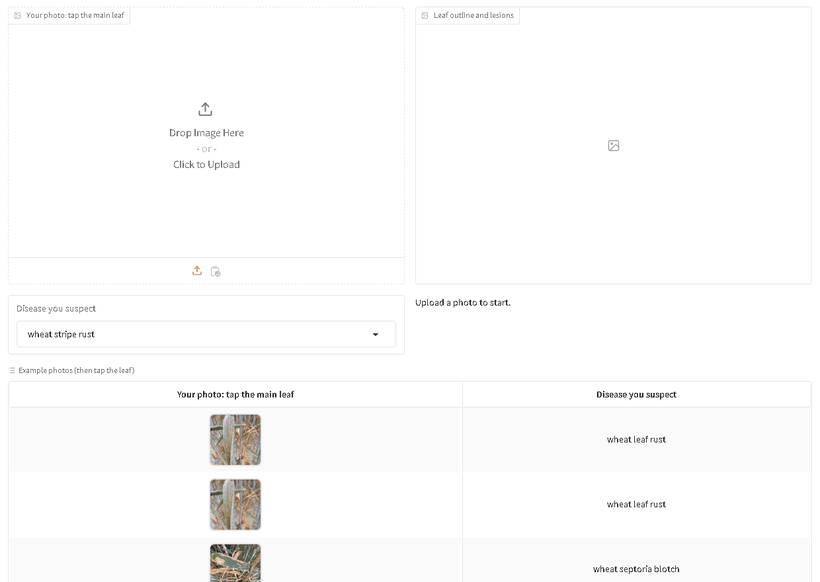
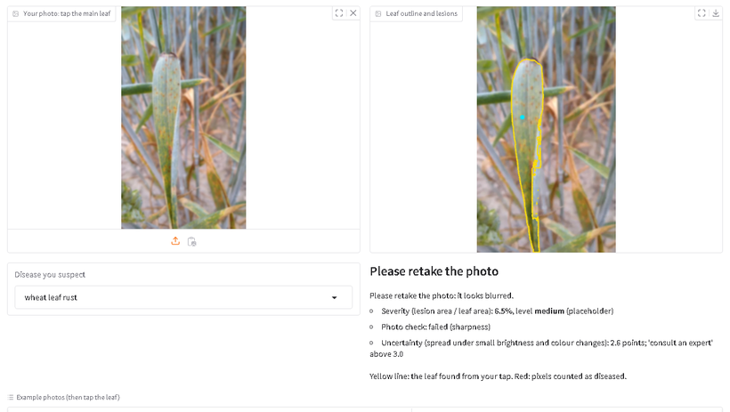
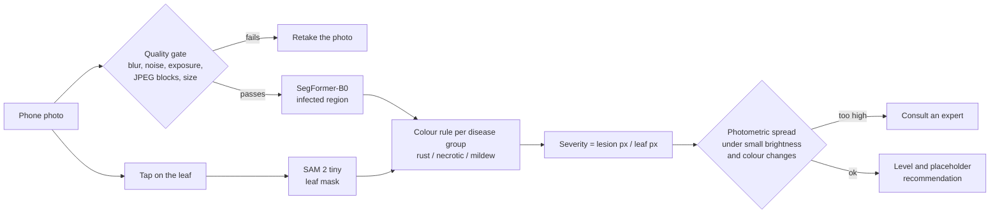
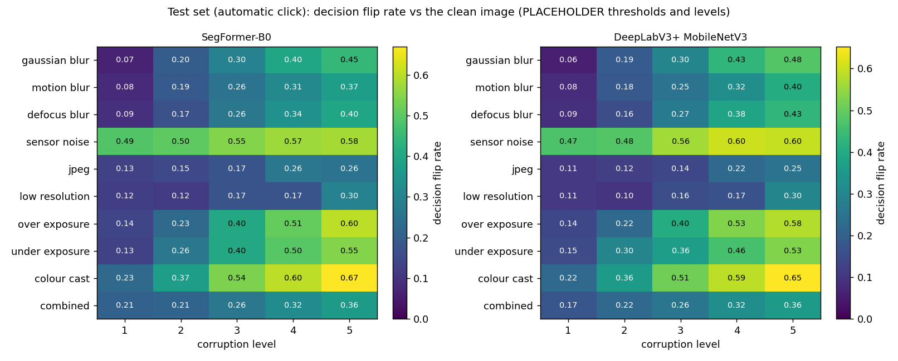
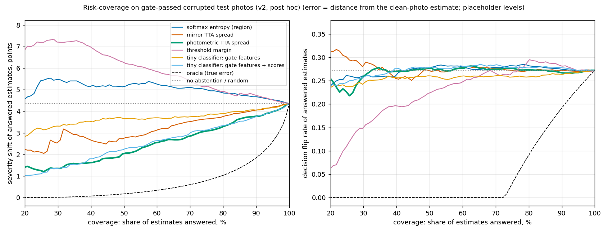

# Field-robust wheat disease severity from phone photos

**How much of a wheat leaf is diseased, how far does that estimate move when the photo is bad, and can the
system tell when not to answer?**

Final-year BTech Data Science project. Most plant-disease models name the disease. Farmers also need to know
**how bad** it is, because that decides between "monitor" and "spray now". Phone photos in the field are blurred,
noisy, badly exposed and colour-shifted. This project measures how those faults move a **severity** estimate and
flip the treatment decision, which accuracy numbers hide. It then adds a photo-quality gate and an uncertainty
check, so the system can say **"retake the photo"** or **"consult an expert"** instead of guessing.

[](https://colab.research.google.com/github/adrijas7274/wheat-disease-severity/blob/main/notebooks/demo_colab.ipynb)
**Live demo on Colab** (CPU, about 5 minutes to start, temporary public link), or [run it yourself](#run-it-yourself).



*Stripe rust photo (JIC, CC BY 4.0): tap the leaf; the leaf is outlined in yellow and lesion pixels in red;
severity 9.2%, level "medium", photo check passed, uncertainty 1.9 below the 3.0 limit, so the demo answers.*

<details>
<summary>The "retake the photo" case</summary>



*The same kind of leaf-rust photo with blur added: the photo check fails on sharpness, so no recommendation is
given.*
</details>

> **Decision support, not expert advice.** The severity levels (0%, 5%, 20%) and the recommendations are
> **placeholders**, not validated against an agronomy source.

## What is new here

1. **Severity robustness benchmark:** 10 phone-style corruptions × 5 levels, scored on severity and on
   treatment decisions, not just segmentation accuracy.
2. **Decision flip rate:** how often a worse photo changes the recommended action.
3. **Abstention:** a quality gate plus a cheap uncertainty score, evaluated with risk–coverage curves.
4. **Severity = lesion area ÷ leaf area**, with leaf masks from SAM 2 and a visual gold standard (54 rated
   images, locked before any method existed).
5. **Two external wheat field sets**, including one held out until the pipeline was frozen.

## Pipeline (frozen as `final-v1`)



- **Region:** SegFormer-B0 (3.7 M parameters, 15 MB), trained on PlantSeg wheat leaf images (5 leaf diseases).
  PlantSeg's masks are coarse **infected regions**: 55–74% of the masked area looks healthy. So the model
  finds the region, and a colour rule picks the lesion pixels inside it.
- **Leaf:** SAM 2.1 hiera-tiny, prompted with one tap (in the evaluations, an automatic click from the region).
- **Colour rule:** CIELAB thresholds per disease group, tuned on 12 rated images. No colour preprocessing
  (see the Phase 5 trade-off below).
- **Gate and uncertainty:** fitted on the validation split only; uncertainty is the spread of the estimate
  over small brightness and colour changes.

## Key results

All numbers come from `report/tables/`. CIs are 95% bootstrap intervals. Flip rates use the placeholder levels.

### 1. Severity against the gold standard (37 test images, one rater)

| method | MAE, points (95% CI) | same level as the rating |
|---|---|---:|
| predicted region clipped to the leaf | 59.0 (49.0–67.4) | 22% |
| **region + colour rule (the method)** | **14.4 (10.0–19.2)** | 22% |

The rater's own test–retest difference is **3.64 points**, which is the resolution limit for every comparison.
The method is unbiased on average (mean signed error +1.2) but about four times the rating noise. High-severity
leaves are underestimated (MAE 27 points above 20% severity). Level agreement is low (22%): most often a
"medium" rating is estimated as "low" or "none" (13 of 37 images).

### 2. Robustness: phone faults move severity much more than segmentation accuracy shows

Test split (121 images), SegFormer-B0, level 5 of each corruption:

| corruption | region mIoU (clean 0.658) | severity shift, points | decision flip rate |
|---|---:|---:|---:|
| colour cast | 0.647 | 16.8 | 0.67 |
| sensor noise | 0.514 | 14.2 | 0.58 |
| over-exposure | 0.562 | 12.9 | 0.60 |
| under-exposure | 0.604 | 11.7 | 0.55 |
| Gaussian blur | 0.541 | 7.5 | 0.45 |
| JPEG | 0.595 | 6.8 | 0.26 |
| low resolution | 0.576 | 4.0 | 0.30 |

**A strong colour cast barely changes mIoU (0.658 → 0.647) but flips 67% of decisions.** The fragile part is
the colour rule, not the network.



### 3. Making the colour stage robust: a trade-off, not a fix

Colour preprocessing (denoise + shades-of-gray + exposure) cut the mean flip rate from 0.32 to 0.20. That was
the pre-registered Phase 5 result. External photos then showed it got there partly by **missing disease**: septoria
photos detected fell to 6% (from 84%). A post-hoc rerun with per-disease guards (detection, false alarms on 250
healthy leaves, tuning error) let **no** preprocessing variant through in any disease group.

| test split, v1 preprocessing → final (none) | clean estimates = 0% | severity shift | flip rate |
|---|---|---|---|
| septoria blotch (n = 24) | 50% → 29% | 4.98 → 9.62 | 0.27 → 0.36 |
| bacterial leaf streak (n = 17) | 65% → 47% | 2.13 → 3.79 | 0.15 → 0.30 |
| stripe rust (n = 43) | 16% → 26% | 4.15 → 5.23 | 0.20 → 0.30 |
| all diseases | 28% → 27% | 4.27 → 5.71 | 0.20 → 0.32 |

**Finding:** within the guards, colour preprocessing traded detection for stability. The final pipeline keeps
detection and accepts the instability, which the gate and the uncertainty check then have to handle.

### 4. Quality gate and abstention (final pipeline, test split)

| | retake | consult an expert | answered |
|---|---:|---:|---:|
| clean photos | 7% | 22% | 70% |
| corrupted photos | 44% | 11% | 45% |

- Answered corrupted estimates move **3.27 points** on average, against 5.71 with no policy. Among photos that
  pass the gate, answering 80% cuts the shift by 25%.
- **Abstention does not reduce the decision flip rate** (0.27 with or without it). Many estimates sit near
  the 0% and 5% boundaries, so small shifts still flip the decision.
- Catch rates (unreliable estimates refused): blur 78–92%, under-exposure 86%, JPEG 69%, **colour cast 41%**.



### 5. External wheat field photos (image labels only, so detection rather than severity error)

| | Mendeley Wheat Leaf (Ethiopia)\* | JIC (UK), independent, evaluated once |
|---|---:|---:|
| stripe rust detected (> 0%) | 96% (n = 208) | 82% (n = 239) |
| leaf rust detected | – | 88% (n = 128) |
| septoria detected | 84% (n = 97) | **58%** (n = 349) |
| powdery mildew detected | – | 80% (n = 161) |
| healthy leaves > 0%, mildew rule | 36% (n = 101) | **63%** (n = 122) |
| healthy leaves > 0%, rust rule | 14% | 29% |
| sent back for a retake | 4–25% | 3–6% |

\* Not independent: the septoria problem in section 3 was found on this set. JIC (Zenodo 7573133) was not
downloaded until the pipeline was tagged `final-v1`, and was evaluated once.

### 6. Phone readiness (region model)

SegFormer-B0 exported to ONNX (fixed 512 × 512 input) and quantised with onnxruntime. Clean test split, laptop CPU
(Intel, 4 threads), model only:

| format | size | CPU latency | test IoU\* | agreement with FP32 |
|---|---:|---:|---:|---:|
| PyTorch FP32 | 14.9 MB | 280 ms | 0.682 | – |
| ONNX FP32 | 15.0 MB | 158 ms | 0.682 | 1.000 |
| ONNX INT8 dynamic (MatMul/Gemm only) | 7.8 MB | 162 ms | 0.680 | 0.978 |
| **ONNX INT8 static** (QDQ, calibrated on 100 training images) | **4.5 MB** | 155 ms | 0.685 | 0.911 |

\* Pooled over pixels, so not the same number as the per-image IoU (0.658) in section 2. It is used only to compare formats.

- INT8 static meets the < 15 MB target with no IoU loss. It changes about 9% of the predicted region, and how that
  moves severity was not measured. It is not faster on a laptop CPU; phone latency is unmeasured.
- **TFLite was not produced**: it needs a separate TensorFlow toolchain (onnx2tf) and was left as future work.
- The leaf model is the blocker: **SAM 2.1 tiny (156 MB) does not fit a 2–3 GB phone** and needs a phone-sized
  promptable segmenter (MobileSAM / EfficientSAM class), not evaluated here. The whole demo pipeline takes about
  2 s per photo on a laptop CPU.

## Data-quality findings (PlantSeg wheat)

- **Masks are coarse:** 55–74% of the masked area is healthy-looking tissue (unvalidated HSV heuristic).
- **The official split leaked:** 22 test and 17 validation images had a near-duplicate in training. They
  were removed from training and the models retrained.
- **Labels conflict:** 12 near-duplicate pairs carry two different disease names.
- **Masks are not reproducible:** two masks of the same photo agree with a median IoU of 0.83 (lowest 0.18).
- **No healthy images:** every PlantSeg wheat photo is labelled diseased, so healthy-leaf false alarms had to
  be measured on other datasets.

## Limitations

- **Colour casts are the biggest weakness.** A yellow or blue tint (wrong white balance) moves the estimate by
  up to 17 points. The photo check catches only 12% of the affected estimates and the full policy 41%. Answered
  colour-cast estimates still move about 8 points.
- **Septoria is often missed on photos from new sources.** On the independent JIC set only 58% of septoria
  photos get any severity above 0%, and 42% get exactly 0%, which would mean "no action".
- **Healthy leaves get false alarms**, especially under the powdery-mildew rule: 63% of healthy JIC leaves and
  36% of healthy Mendeley leaves get some severity above 0%. On JIC, 6–8% of healthy leaves reach the "high"
  level under each rule. Abstention does not remove these, because the estimate is stable and confidently wrong.
- **Placeholder thresholds and recommendations.** The 5% and 20% levels and the actions are not validated by an
  agronomist.
- **One rater, small gold set.** 54 rated images (37 used after the leaf check), one person, mean error 14
  points. Clean-photo estimates are 0% on 27% of diseased test leaves (possible missed mild disease).
- **Stability, not correctness.** The robustness and abstention numbers compare each estimate with the same
  method on the clean photo, not with a rating.
- **Corruption levels are hand-set**, not measured from real low-end phones; the "combined chain" is not a
  model of a specific camera.
- **Post-hoc rounds.** Phase 5 v2 and Phase 6 v2 were designed after seeing earlier results. Both were fitted on
  validation data and evaluated once, and both are labelled post hoc. JIC is the only fully held-out check.
- **The user picks the disease.** There is no disease classifier, and the healthy-leaf result depends on which
  colour rule is run.
- **Not on a phone yet.** Only the region model is exported. SAM 2 tiny (156 MB) is too big for a 2–3 GB phone
  and needs a phone-sized replacement. No Android app was built.
- One region model and one training seed. External sets have image-level labels only.

## Run it yourself

Python 3.10–3.12, CPU only. In a fresh virtual environment:

```bash
git clone https://github.com/adrijas7274/wheat-disease-severity.git && cd wheat-disease-severity
pip install -r demo/requirements.txt && SAM2_BUILD_CUDA=0 pip install --no-build-isolation sam2==1.1.0
python demo/app.py                                    # then open http://127.0.0.1:7860
```

On Windows PowerShell, set the variable first: `$env:SAM2_BUILD_CUDA="0"`. The first start downloads SAM 2.1 tiny
(156 MB) from Meta and checks its SHA-256; the region model (`checkpoints/segformer_b0.pt`) is in the repository.
Each photo takes about 2 s on a laptop CPU.

## Reproducing the results

```bash
python -m venv .venv && .venv/Scripts/activate      # Windows; source .venv/bin/activate elsewhere
pip install -r requirements.txt                       # see the file for the Windows CUDA and sam2 notes
pytest                                                # unit tests
```

Data (not in the repository): PlantSeg v7 (Zenodo 17719108) under the paths in `configs/config.yaml`; SAM 2.1
tiny checkpoint (URL and SHA-256 in `experiments/LOG.md`, 2026-11-01); external sets as recorded in
`report/dataset_versions.md`.

| step | command | output |
|---|---|---|
| region models | `python -m src.train --config configs/config.yaml --model segformer` (and `--model deeplabv3plus`) | `experiments/<run>/`, `report/tables/baselines.md` |
| gold evaluation | `python -m src.severity.evaluate_gold --gold` (run once at `phase3-method-v1`; do not re-run for tuning) | `report/tables/gold_evaluation.md` |
| robustness benchmark | `python -m src.corruptions.benchmark --experiment configs/experiments/phase4_benchmark.yaml` | `report/tables/robustness.md` |
| colour stage v1 / v2 | `python -m src.severity.phase5_colour_stage`, `python -m src.severity.phase5_v2` | `report/tables/phase5_*.md` |
| abstention (final) | `python -m src.uncertainty.phase6 --experiment configs/experiments/phase6_on_phase5_v2.yaml`, then `python -m src.uncertainty.phase6_v2 --experiment configs/experiments/phase6_v2_on_phase5_v2.yaml` | `report/tables/abstention_final.md` |
| external sets | `python -m src.external.phase7 --part mendeley --experiment configs/experiments/phase7_{mendeley_final,jic}.yaml` | `report/tables/phase7_*.md` |
| export | `python -m src.export` | `report/tables/export.md` |
| demo | `python demo/app.py` (`python -m src.demo.export_policy` rebuilds `demo/final_policy.json` from your own runs) | http://127.0.0.1:7860 |

Every run writes `experiments/<timestamp>_<name>/` with its config, git commit and metrics. `experiments/LOG.md`
records every decision and when each rule was frozen (`gold-v1`, `phase3-method-v1`, `phase6-v2-prereg`,
`phase5-v2-prereg`, `final-v1`). These names are tags and commit hashes in the private development history;
this public repository is a single snapshot of `final-v1` plus documentation. Each script's docstring has its
full usage line.

## Repository layout

```
configs/   config.yaml (crop, paths, seeds, placeholder thresholds) and one YAML per experiment
src/       data, models, corruptions, severity, uncertainty, external, demo, export (all core code)
demo/      Gradio app, frozen policy values, example photos, demo requirements, Hugging Face deployment notes
checkpoints/segformer_b0.pt   the final region model (CC BY-NC 4.0)
notebooks/demo_colab.ipynb    the Colab demo
tests/     pytest
report/    tables, figures and draft sections; dataset_versions.md records every dataset and licence
experiments/LOG.md   running decision and results log (run folders are gitignored)
```

## Data, credits and licences

- **PlantSeg** (training and in-domain test): Wei, T., Chen, Z., Yu, X., Chapman, S., Melloy, P. & Huang, Z.
  *PlantSeg: A Large-Scale In-the-wild Dataset for Plant Disease Segmentation*, arXiv:2409.04038 (2024); dataset
  v7, Zenodo, https://doi.org/10.5281/zenodo.17719108, **CC BY-NC 4.0**. The trained model and figures derived
  from PlantSeg are therefore for **non-commercial use** (`report/figures/ATTRIBUTION.md`).
- **Mendeley Wheat Leaf Dataset:** Getachew, H. (2021), https://doi.org/10.17632/wgd66f8n6h.1, CC BY 4.0.
- **JIC wheat disease images:** Long, M. C., Hartley, M., Morris, R. J. & Brown, J. K. M. (2023), Zenodo,
  https://doi.org/10.5281/zenodo.7573133, CC BY 4.0. The demo's example photos come from this set.
- **Bangladesh wheat disease set (healthy leaves only):** Radowan, M. I. R. & Ayon, R. A. (2025),
  https://doi.org/10.17632/5gc7hwydwg.1, CC BY 4.0.
- **SAM 2** (Meta, Apache 2.0); **SegFormer** (Xie et al., 2021) via Hugging Face `transformers`, initialised
  from `nvidia/segformer-b0-finetuned-ade-512-512`.
- Gold severity ratings and leaf clicks: by the author.

### Licences of this repository

| what | licence |
|---|---|
| source code | **MIT** (`LICENSE`) |
| trained weights (`checkpoints/segformer_b0.pt`, the SegFormer-B0 region model) | **CC BY-NC 4.0**: trained on PlantSeg, non-commercial |
| derived data: gold ratings and clicks, tags, leaf-check logs, tables and figures derived from PlantSeg | **CC BY-NC 4.0**, with the PlantSeg attribution above |
| photos and overlays from the Mendeley and JIC sets (`report/figures/phase7*`, `report/figures/demo/`, `demo/examples/`) | **CC BY 4.0** (their authors' licences) |

Figure-by-figure attribution: `report/figures/ATTRIBUTION.md`.
